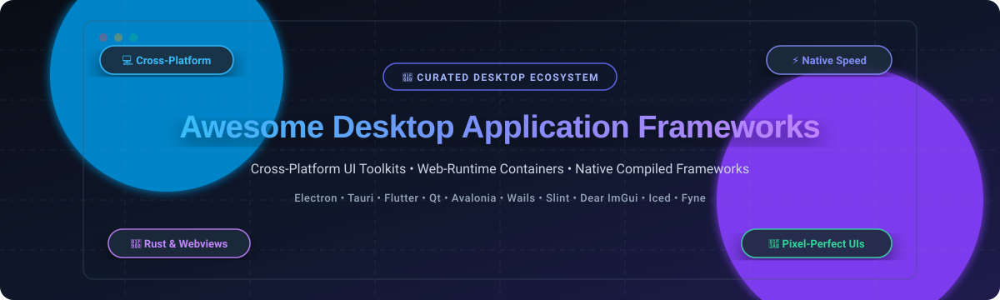

# Awesome-Desktop-Application-Frameworks

  

  
  
  
  
  
  

---

## 🎯 Top Desktop Application Frameworks Ecosystem

> A comprehensive, SEO-optimized, and curated collection of the best **desktop application frameworks**, **cross-platform GUI libraries**, **native UI toolkits**, and **web-to-desktop runtimes**. Build high-performance, lightweight, and cross-platform desktop software for Windows, macOS, and Linux.

**Curated List of SaaS Products & Open-Source GitHub Projects**  
*Focused on Cross-Platform UI, Native Performance, Skia / GPU Rendering, & Modern Web-Technology Runtimes*  
**Last updated: October 2026**

This repository tracks notable **SaaS platforms** and **open-source frameworks** for **Desktop Application Development**. These tools empower software engineers and enterprises to build installable, production-ready desktop apps—ranging from native C++ and Rust toolkits rendering directly to GPU canvases, to lightweight webview bridges (Tauri, Wails, Neutralinojs) and complete web runtimes (Electron).

### ⚡ Quick Navigation / Table of Contents
- [📊 Sector Overview & Market Dynamics](#-sector-overview--market-dynamics)
- [💼 SaaS & Commercial Platforms](#-saas--commercial-platforms)
- [⭐ Open-Source GitHub Frameworks](#-open-source-github-frameworks)
  - [Top Tier Frameworks (Ranked by Stars)](#top-tier-frameworks-ranked-by-stars)
  - [Specialized & Emerging Open-Source Frameworks](#specialized--emerging-open-source-frameworks)
- [📈 Star History](#-star-history)
- [💖 Support & Sponsorship](#-support--sponsorship)
- [🤝 How to Contribute](#-how-to-contribute)
- [⚖️ Disclaimer & Evaluation Guidelines](#️-disclaimer--evaluation-guidelines)

---

## 📊 Sector Overview & Market Dynamics

The global cross-platform application development software and desktop tooling market is valued between **$8.7 billion and $138+ billion** (with the broader software platform category projected to scale from $33B to over $800B+ across the next decade). The sector exhibits **moderate-to-high fragmentation** characterized by distinct technological niches—ranging from web-runtime stacks (Electron, Tauri) and managed runtimes (.NET MAUI, Avalonia) to heavyweight compiled C++ frameworks (Qt) and proprietary rapid enterprise toolkits (RAD Studio)—preventing a single "winner-take-all" monopoly.

---

## 💼 SaaS & Commercial Platforms

| Platform | Valuation / Revenue | Starting Price | Free Tier / Trial Limits | Description & Trade-offs |
| :--- | :--- | :--- | :--- | :--- |
| **Idera / Embarcadero RAD Studio** | Valuation: ~$1.125B (Idera) / Revenue: ~$100M-$250M+ (Idera) | $2,573/yr (Named User Perpetual with 1st year Update Subscription) | 30-day full-featured free trial (or Delphi/C++Builder Community Edition: limited to $5,000/yr gross revenue & max 5 users) | **Windows-native rapid application development** with Delphi and C++Builder. Proprietary and primarily Windows-optimized - best for teams maintaining mission-critical Windows applications with deep native API integration. |
| **The Qt Company (Qt Commercial)** | Valuation: ~$920M-$1.0B (EUR 825M-970M Market Cap) / Revenue: ~EUR 216.3M (~$235M) | EUR 546/yr (~$618/yr, Small Business tier; $3,950/dev/yr for Enterprise) | 10-day evaluation trial (full commercial features for evaluation only; perpetual free tier available via LGPLv3/GPLv3 Open Source edition) | **Cross-platform application and UI framework** for desktop, embedded, and mobile. The reference standard for native C++ desktop apps; trade-offs include C++ learning curve and commercial licensing costs. |

---

## ⭐ Open-Source GitHub Frameworks

The open-source desktop ecosystem is diverse, offering options across JavaScript/TypeScript, Rust, Go, Python, C++, and C#. All frameworks below are sorted by GitHub stars in descending order.

### Top Tier Frameworks (Ranked by Stars)

- **Flutter (Desktop)**   
  **Google's UI toolkit for natively compiled applications** (BSD-3-Clause) — *the pixel-perfect multi-platform choice*. Compiles to native Windows, macOS, and Linux desktop binaries from a single Dart codebase. Utilizes custom Skia and Impeller rendering engines to draw every pixel natively on the GPU with hot reload support.  
  * **Trade-off:** System interaction (raw OS hardware, low-level platform APIs) requires native plugins or FFI compared to Qt.

- **Electron**   
  **Build cross-platform desktop apps with JavaScript, HTML, and CSS** (MIT) — *the web-technology standard*. Bundles Chromium and Node.js into every application, powering VS Code, Slack, Discord, and Figma. Massive npm ecosystem and rapid development.  
  * **Trade-off:** High bundle size (≈385MB on Windows, ≈296MB on Linux) and high baseline RAM usage (≈250MB+).

- **Tauri**   
  **Build smaller, faster, and secure desktop apps with web frontends** (MIT/Apache-2.0) — *the lightweight web-technology choice*. Replaces Chromium by delegating to the operating system's native webview (WebView2 on Windows, WebKitGTK on Linux, WebKit on macOS) coupled with a secure Rust backend. Bundle sizes can be under 3MB.  
  * **Trade-off:** Compiling the Rust core results in slower initial build times compared to pure Node.js environments.

- **Dear ImGui**   
  **Bloat-free Immediate Mode Graphical User Interface for C++** (MIT) — *the real-time, game engine, and tooling standard*. Highly optimized, portable, and renderer-agnostic GUI library designed for game developers, debug overlays, internal content creation suites, and visualization utilities.  
  * **Trade-off:** Immediate-mode paradigm differs significantly from traditional retained-mode application UI architectures.

- **Wails**   
  **Build desktop apps using Go and Web Technologies** (MIT) — *the Go developer's lightweight choice*. Integrates native webviews with Go backends, providing fast native execution, concise code, and compact binary distribution sizes (~10-15MB).  
  * **Trade-off:** Requires Go toolchain; uses OS webviews which may introduce subtle cross-platform CSS/rendering variations.

- **Iced**   
  **A cross-platform GUI library for Rust focused on simplicity and type-safety** (MIT) — *the Elm-inspired Rust choice*. Features a reactive architecture, modular renderer backends (wgpu), first-class async runtime integration, and clean memory guarantees without webviews.  
  * **Trade-off:** Rapidly evolving API; smaller ecosystem of pre-built third-party components than mature toolkits.

- **Avalonia UI**   
  **A cross-platform UI framework for .NET** (MIT) — *the WPF-everywhere choice*. Uses XAML layout, C# logic, and MVVM patterns to render pixel-perfect UIs via Skia on Windows, macOS, and Linux (including native Wayland backend support).  
  * **Trade-off:** Packaging and auto-updaters require integrating community .NET tooling (such as Velopack).

- **Fyne**   
  **Cross-platform GUI in Go based on Material Design** (BSD-3-Clause) — *the pure Go native renderer*. Renders UI natively using OpenGL/Vulkan via Go without any web browser or CGO dependencies on modern setups, targeting desktop and mobile seamlessly.  
  * **Trade-off:** Strict adherence to its Material Design layout conventions makes heavily customized non-standard UI designs more complex.

- **Slint**   
  **Declarative GUI toolkit for Rust, C++, and JavaScript** (GPLv3/Commercial) — *the embedded and high-performance choice*. Extremely low memory footprint (<300KB RAM baseline) with a dedicated UI markup language and live-preview tooling.  
  * **Trade-off:** Open source licensing under copyleft GPLv3 requires purchasing a proprietary license for closed-source commercial deployments.

- **.NET MAUI**   
  **.NET Multi-platform App UI** (MIT) — *the official Microsoft multi-device choice*. Evolution of Xamarin.Forms allowing developers to build native mobile and desktop applications from a single C# and XAML codebase.  
  * **Trade-off:** Desktop tooling and ecosystem maturity historically lag behind mobile target platforms.

- **Kivy**   
  **Open source Python framework for rapid development of innovative UIs** (MIT) — *the Python multi-touch choice*. Hardware-accelerated OpenGL ES 2 rendering with custom widget trees and natural multitouch event support across Linux, Windows, macOS, Android, and iOS.  
  * **Trade-off:** Uses non-native custom styling by default; packaging Python runtimes for standalone desktop distribution can require complex freezing scripts.

- **Dear PyGui**   
  **Fast and powerful Graphical User Interface toolkit for Python** (MIT) — *the high-performance Python choice*. Built on top of Dear ImGui with GPU acceleration via DirectX, Metal, and OpenGL. Excellent for data science, engineering tools, and real-time visualization.  
  * **Trade-off:** Geared towards utilities, simulation tools, and dashboards rather than traditional document-centric business software.

- **Uno Platform**   
  **Pixel-perfect WinUI across Windows, macOS, Linux, iOS, Android, and WebAssembly** (Apache-2.0) — *the WinUI-everywhere choice*. Allows C# and XAML developers to run modern Windows App SDK / WinUI code across desktop and web with single-source efficiency.  
  * **Trade-off:** WebAssembly desktop targets are heavyweight and require modern client browser engines.

- **JUCE**   
  **Cross-platform C++ framework for audio applications and plug-ins** (ISC/GPLv3/Commercial) — *the audio industry benchmark*. De-facto standard for building VST, AU, and AAX synthesizer plug-ins and standalone music software with real-time audio threads and graphics.  
  * **Trade-off:** Specialized for audio and DSP applications rather than general business CRUD applications.

- **Neutralinojs**   
  **Lightweight and portable cross-platform desktop application SDK** (MIT) — *the ultra-lightweight webview runtime*. Generates lightweight binary bundles (~2MB) by consuming system webviews and executing a lightweight C++ daemon without embedding Node.js.  
  * **Trade-off:** Does not include built-in Node.js runtime bindings in the host process; backend extensions must communicate over web sockets.

- **wxWidgets**   
  **Cross-platform GUI library with genuine native look and feel** (wxWindows Licence) — *the OS-native widgets standard*. Wraps true platform-native controls on Windows, macOS (Cocoa), and Linux (GTK), ensuring zero visual uncanny valley and full OS compliance.  
  * **Trade-off:** Classical C++ programming model; modern smooth declarative animations and reactive state pipelines require supplementary architecture.

- **Qt (Open-Source Edition)**   
  **Cross-platform C++ GUI framework with extensive native libraries** (LGPLv3/GPLv3) — *the native performance powerhouse*. Powers major engineering software, automotive dashboards, and medical instrumentation with C++ and QML declarative styling.  
  * **Trade-off:** LGPL compliance mandates dynamic linking and relinking capabilities for proprietary applications.

---

### Specialized & Emerging Open-Source Frameworks

- **Pyloid**  — **Python backend version of Electron and Tauri** (Apache-2.0). Combines QtWebEngine and PySide6 to bring web frontends directly into Python's machine learning and data science ecosystem.
- **libui-ng**  — **C-based native GUI library** (MIT). Provides clean, portable C bindings to native operating system controls (Win32, Cocoa, GTK) with zero third-party baggage.
- **Adrenaline.js** — **Ultra-lightweight Electron alternative** (Open Source). Offers a drop-in Electron-compatible API on top of native OS webviews to deliver ~5-10MB bundle sizes with pure Node.js ergonomics.

---

## 📈 Star History

---

## 💖 Support & Sponsorship

Thank you for visiting and supporting this ecosystem directory! If you find this curated collection helpful for your desktop architecture decisions:

- ⭐ **Star** this repository to show your appreciation and help others discover it.
- 🍴 **Fork** it to keep a personal copy or contribute your favorite tools.
- 📢 **Share** it with fellow software engineers, colleagues, and open-source communities.
- ☕ **Sponsor / Buy Me a Coffee:** Support ongoing maintenance, research, and open-source documentation via the [GitHub Sponsor Dashboard](https://github.com/sponsors/ishandutta2007).

---

## 🤝 How to Contribute

Contributions are welcome and highly appreciated! To submit a framework or platform:

1. **Fork** the repository.
2. **Add/Edit** entries in `README.md` following the existing format.
3. Include the framework's name, GitHub repository or official site link, license, star count badge, and a concise 1–2 sentence description of trade-offs and best use cases.
4. Open a **Pull Request** with a brief summary of the submission.

---

## ⚖️ Disclaimer & Evaluation Guidelines

- 📌 This list is **community-curated** for architectural discovery and comparison—not an endorsement.
- 📦 **Bundle Size & Memory Footprint:** Frameworks bundling full browser engines (Electron: ~300MB+ bundle, ~250MB+ RAM) trade footprint for guaranteed DOM consistency. Frameworks using OS webviews (Tauri, Wails, Neutralinojs: ~2-15MB) reduce size dramatically but depend on host OS webview versions.
- 🎨 **Native vs. Self-Rendered:** Canvas/Skia engines (Flutter, Avalonia, Slint) draw every pixel identically on all platforms. Native control wrappers (wxWidgets, libui-ng) provide 100% native OS look-and-feel.
- 📜 **Licensing Considerations:** Check whether libraries are permissive (MIT, Apache-2.0, BSD) or copyleft (LGPLv3, GPLv3). If deploying proprietary commercial software, ensure compliance with source-linking rules.

---

  <b>Made with ❤️ for application developers, desktop engineers, and platform architects building native-grade desktop solutions.</b>

